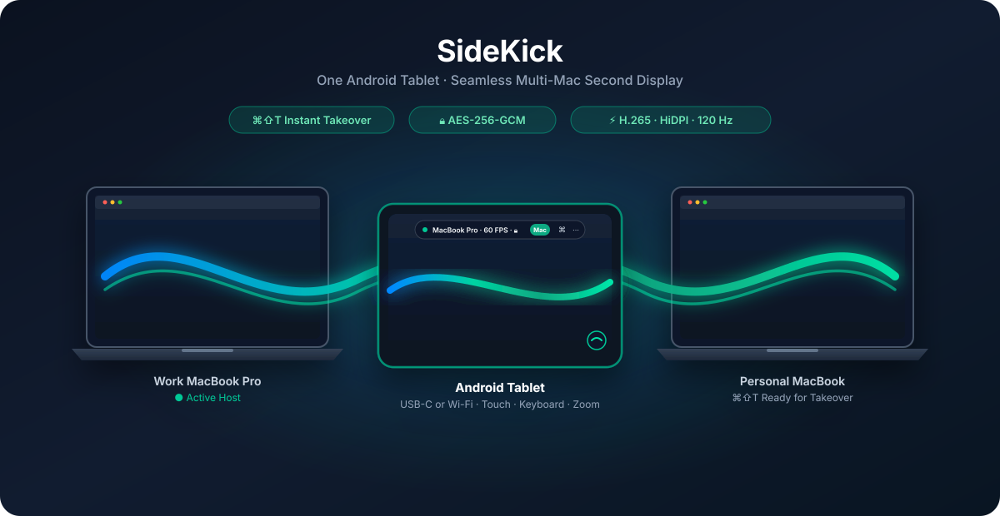
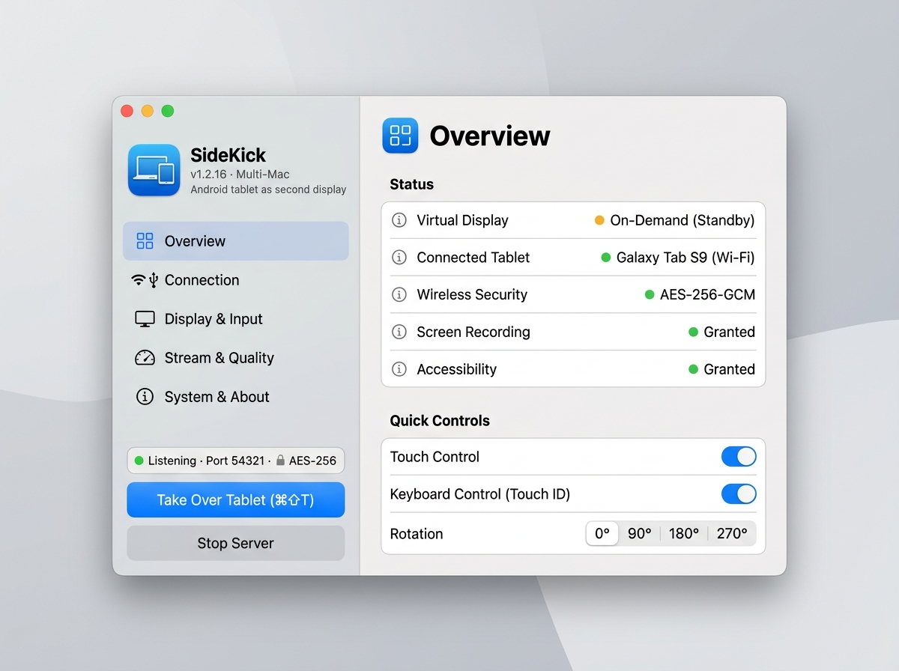
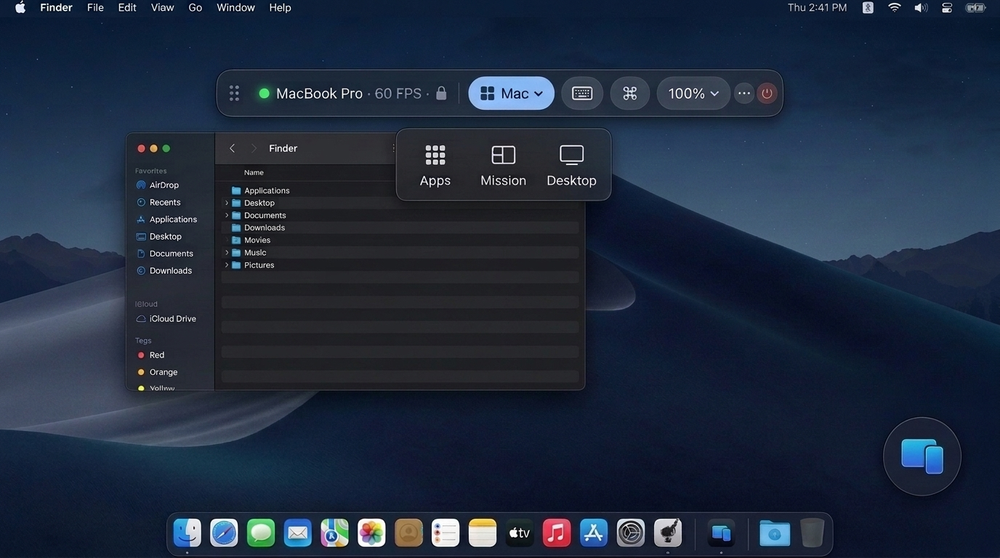
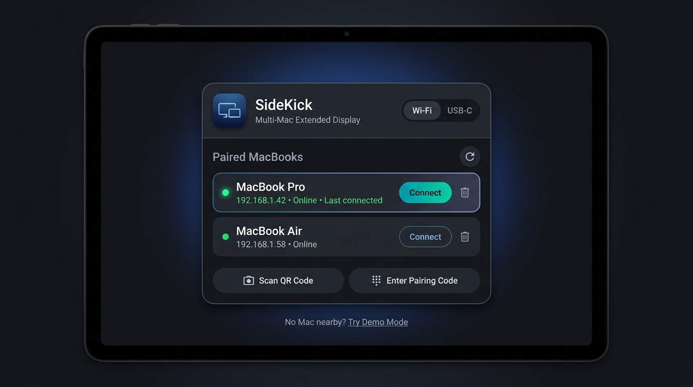

<a id="readme-top"></a>

<div align="center">


<h1>SideKick</h1>

<p><em>Turn your Android tablet into a true second display across multiple MacBooks — USB-C or wireless over WiFi with instant Multi-Mac Takeover</em></p>

<p>
  <a href="https://github.com/kleinski/SideKick/releases">
    
  </a>
  <a href="https://github.com/kleinski/SideKick/blob/main/LICENSE">
    
  </a>
</p>


</div>

---

## Origin & Attribution: Original `SideScreen` vs. `SideKick`

**SideKick** is an independent fork of [**SideScreen**](https://github.com/tranvuongquocdat/SideScreen), originally created by [**Tran Vuong Quoc Dat**](https://github.com/tranvuongquocdat) ([sidescreen.dev](https://sidescreen.dev)).

> **🙏 A Huge Thank You to Tran Vuong Quoc Dat**
>
> All credit for the foundational architecture — the ultra-low-latency hardware-accelerated H.265 streaming pipeline, the native macOS `CGVirtualDisplay` integration, the Android `MediaCodec` decoder, and predictive touch input — goes to **Tran Vuong Quoc Dat**.
>
> I am deeply grateful for his outstanding engineering work on **SideScreen** and for his generous decision to release the entire project as open source under the **[MIT License](LICENSE)**. Without his craftsmanship and commitment to open source, **SideKick** would not exist. If you enjoy using SideKick, please consider [supporting his original work](#acknowledgements--upstream-support)!

While the original [**SideScreen**](https://github.com/tranvuongquocdat/SideScreen) provides an exceptional open-source streaming engine for connecting an Android tablet to a Mac — and [**SideScreen Pro**](https://www.sidescreen.dev/pro.html) expands it with **up to 3 simultaneous tablets per Mac**, **Mac audio on the tablet**, and **per-tablet settings** — **SideKick** takes a complementary direction focused on **seamless wireless multi-Mac workflows** (moving one Android tablet effortlessly between two or more MacBooks) along with E2E encryption, keyboard forwarding, and an interactive tablet control overlay.

> **Which one should you choose?**
> - Choose [**SideScreen Pro**](https://www.sidescreen.dev/pro.html) (paid one-time license by Tran Vuong Quoc Dat / WNX Studio) if you want **multiple tablets connected simultaneously to one Mac** (up to 3), **Mac sound routed to your tablet**, and a direct way to support the original creator.
> - Choose **SideKick** (this free, MIT-licensed fork) if you want **one tablet switching seamlessly between multiple MacBooks**, **AES-256-GCM wireless encryption**, **hardware/on-screen keyboard & Mac shortcut forwarding**, **zoom/pan controls**, and an **on-demand virtual display** that disappears automatically on disconnect.
> - **But, why not use Side Screen and SideKick in parallel? 😉** Thanks to separate app/package IDs (`com.sidescreen.app` vs. `com.sidekick.app`) and configurable ports, both apps can happily live side by side on the same Mac and Android tablet.

### Comparison: `SideScreen` (Free) vs. `SideScreen Pro` vs. `SideKick`

| Capability | Original `SideScreen` (Free) | `SideScreen Pro` ([sidescreen.dev/pro](https://www.sidescreen.dev/pro.html)) | `SideKick` Fork (My Additions) |
|---|---|---|---|
| **Core Streaming Engine** | Hardware-accelerated H.265/H.264 (`VideoToolbox` → `MediaCodec`), sub-16ms USB / <30ms WiFi | Included | Inherited from upstream |
| **Virtual Display & Input** | Native macOS `CGVirtualDisplay`, HiDPI (Retina 2×), 30–120 FPS, Gaming Boost, Touch Prediction | Included | Inherited from upstream |
| **Simultaneous Tablets per Mac** | 1 tablet | **Up to 3 tablets simultaneously** (mixed USB-C / Wi-Fi) | 1 tablet |
| **Mac Audio on Tablet** | — | **Yes** (each display as a macOS sound output) | — |
| **Multi-Mac Pairing & Discovery** | Single paired Mac | Per-tablet settings (3 Macs per license) | **Multi-Mac Pairing + Periodic Bonjour Scan (`_sidescreen._tcp`):** Store all paired MacBooks persistently, configurable Auto-Scan interval (`Off / 5s / 10s / 30s / 60s`), live online status, Auto-Connect & in-app update check right on the Home Screen |
| **Switching Between Macs** | Manual disconnect + re-pair | Manual | **Two-Way Instant Takeover (`⌘⇧T`):** Pull the tablet via HMAC-SHA256 UDP handover (`54322`) or tap **Switch Mac** directly in the Android Mini-Status-Pill |
| **Virtual Display Lifecycle & Reliability** | Created on server start | Per-tablet display lifecycle | **Strictly On-Demand + Watchdogs (`⌘⇧D`):** Display exists only while streaming; 6s Mac watchdog, Android task-kill teardown, 5s Android heartbeat timeout, and dynamic wake lock |
| **Resolution, HiDPI & Rotation** | Rebuilds server on display changes | Per-tablet resolution, orientation & position | **Live In-Place Rebuild + Orientation Lock:** Resolution, HiDPI, refresh rate, and Portrait/Landscape rotation rebuild live without disconnecting; tablet sensor rotation locked (incl. Android 16 opt-out) |
| **Wireless Security** | Plaintext token handshake (`SSWA`) | Upstream wireless auth | **End-to-End Encrypted Wireless (`SSWE`):** Mutual HMAC-SHA256 challenge-response + **AES-256-GCM** stream encryption (default on) + live lock badge (`🔒`) |
| **Touch, Dragging & Apple Gestures** | Touch & mouse input | Touch & mouse input | **Direct Window Dragging & macOS Trackpad Gestures:** 1-finger drag moves windows/selects text, 2-finger tap (right-click) & scroll, 2-finger pinch-to-zoom, 3-finger swipes (Mission Control, App Exposé, Switch Spaces), 4-finger (Show Desktop, Apps) — each toggleable under *Settings → Gestures* |
| **Keyboard & Mac Shortcuts** | Touch & mouse input | Touch & mouse input | **Hardware & Soft Keyboard + Special Keys (`⌘`):** Full keyboard forwarding (Touch ID / password guard on Mac), auto-hiding soft keyboard button when a physical keyboard is attached, vertical sticky-modifier & shortcut panel (`⌘`/`⌥`/`⌃`/`⇧`, `Esc`/`Tab`/`Del`/arrows, `⌘ Space`/`⌘ Tab`/`⌘⌥ Esc`) |
| **Android Overlay & Zoom/Pan** | Corner stats + settings button | Upstream Android app | **Squircle Mini-Status-Pill + Popovers + Quick Help (`?`):** Draggable single-row frosted-glass pill (`Apple` actions, `Keyboard`, `⌘`, `100% ▾`, `Switch Mac`, `Settings`, `Disconnect`), two-way **Top Notch** or **SideKick Button** trigger, collapsible **Overlay** & **Gestures** settings submenus |
| **macOS Menu Bar & Automation** | Classic `NSMenu` + settings window | Pro Overview & License UI | **Distinct Menu Bar Icon + Sidebar Settings + GitHub Updater:** Custom `laptopcomputer.and.ipad` icon (optional colored teal-green tint), native `NSPopover` (`⌘⇧W`, live `Rotate` picker), 6-section Sidebar Settings, built-in GitHub Releases updater (Homebrew-aware), URL scheme (`sidekick://`), CLI flags & Vorssaint Quick Links |

---

## SideKick Highlights (Added in This Fork)

- **Multi-Mac Wireless Pairing, Periodic Auto-Scan & Home Screen Controls (`_sidescreen._tcp`):** Pair once per MacBook via QR code (or one-time pairing code). The Android Home Screen displays every paired MacBook with live Bonjour/mDNS online status, configurable **Auto-Scan Interval** (`Off` / `5s` / `10s` / `30s` / `60s`), **Auto-Connect**, **Updates**, and a **Quick Help (`?`)** reference popup.
- **Two-Way Instant Takeover (`⌘⇧T`):** Switch the active tablet stream between MacBooks at any time:
  - **From Mac:** Click **Takeover** in the menu bar popover / Settings sidebar footer or press `⌘⇧T` (sends an HMAC-SHA256 authenticated UDP broadcast on port `54322`).
  - **From Android:** Tap **Switch Mac** directly in the Mini-Status-Pill to jump straight to another paired MacBook.
- **End-to-End Wireless Encryption (`SSWE` / AES-256-GCM):** Wireless connections use a mutual HMAC-SHA256 challenge-response handshake (so the 256-bit pairing token is never sent in plaintext over the air) and encrypt all video frames, display configs, touch input, and keyboard events using hardware-accelerated **AES-256-GCM** with per-session ephemeral keys.
- **Direct Window Dragging & Apple-Style Multi-Touch Gestures:** Drag macOS windows, sliders, and text selections directly with **1 finger**; use **2-finger tap** for right-click, **2-finger drag** for momentum scrolling, **2-finger pinch** to zoom the tablet viewport, **3-finger swipes** for **Mission Control** (up), **App Exposé** (down), and **Switch Spaces** (left/right), and **4-finger gestures** for **Show Desktop** (swipe up) and **Open Mac Apps** (tap/swipe down). Every gesture can be enabled or disabled individually under *Settings → Gestures*.
- **Redesigned Android Squircle Mini-Status-Pill & Collapsible Settings:** A compact, single-row, **draggable** frosted-glass pill accented in SideKick teal-green (`#0FA982` / `#00C896`) with dynamically anchored popovers for the **Apple** button (`Apps`, `Mission Control`, `Desktop`), **Zoom** (`-`, `1:1`, `+`, `Fit`), and **Special Keys** (`⌘`), plus direct **Switch Mac**, **Settings**, and **Disconnect** buttons. Choose between a two-way **Top Notch** (toggles overlay both on and off) or a draggable **SideKick Button** trigger, and organize options cleanly inside collapsible **Overlay Settings** and **Gestures** submenus.
- **Tablet-to-Mac Keyboard Forwarding & Auto-Hiding Soft Keyboard Button:** Use a Bluetooth/USB/cover keyboard or tap the **Keyboard** icon on Android to type directly into macOS (including `⌘`, `⌥`, `⌃`, `⇧` shortcuts, navigation, `F1–F12`, and international characters). The on-screen Keyboard button automatically hides whenever a physical keyboard is connected and reappears when disconnected. Re-enabling **Keyboard Control** on the Mac requires **Touch ID / macOS user password**.
- **Distinct macOS Menu Bar Icon, Native `NSPopover` & Sidebar Settings:** Easily distinguishable `laptopcomputer.and.ipad` menu bar icon (with optional colored teal-green status tint in *System → Menu Bar*). Left-click (or press `⌘⇧W`) for live FPS, bitrate, resolution, Start/Stop, Takeover (`⌘⇧T`), Disconnect (`⌘⇧D`), USB/Wi-Fi switch, live `Rotate` (`0° / 90° / 180° / 270°`), and Touch / Keyboard / Encryption toggles. Right-click opens the classic dropdown menu.
- **Built-In GitHub Releases Updater (macOS & Android):** Lightweight zero-infrastructure update checker against GitHub Releases (`kleinski/SideKick/releases/latest`). On macOS (*About & Updates*), it automatically detects Homebrew Cask installs (`Copy brew upgrade`) or offers a direct DMG download; on Android, tap **Updates** on the Home Screen for direct APK downloads.
- **On-Demand Virtual Display, Watchdogs & Dynamic Wake Lock (`⌘⇧D`):** The macOS virtual display is created only when a tablet connects and torn down immediately on disconnect, Android app swipe-away (`DisconnectOnTaskRemovedService`), or after a 6-second Mac liveness timeout. On Android, a 5-second stream heartbeat timeout cleanly returns to the Home Screen if the MacBook powers off or sleeps, and `FLAG_KEEP_SCREEN_ON` is active only while streaming.
- **Live Resolution, HiDPI, Refresh Rate & Rotation Switching:** Change resolution, Retina/HiDPI mode, frame rate, or Portrait/Landscape rotation on the fly — the Mac rebuilds the virtual display in-place without dropping your session. Android tablet sensor rotation is locked (including the Android 16 large-screen opt-out) so only the Mac app controls orientation.
- **URL Scheme, CLI & Vorssaint Command Bar Integration:**
  - **URL Scheme:** `sidekick://takeover`, `sidekick://disconnect`, `sidekick://toggle`, `sidekick://start`, `sidekick://stop`, `sidekick://settings`
  - **CLI Flags:** `/Applications/SideKick.app/Contents/MacOS/SideKick --takeover` (or `--disconnect`, `--toggle`, `--start`, `--stop`, `--settings`)
  - **Vorssaint Integration:** Automatically registers Quick Links when `/Applications/Vorssaint.app` is present (or re-register any time under *Settings → System → Maintenance & Integrations*).

---

<div align="center">
  
</div>

---

## Visual Overview

<div align="center">
  
  <br/>
  <em>macOS Settings with native sidebar navigation, Overview status card, quick controls, and built-in GitHub Releases update checker</em>
</div>

<br/>

<div align="center">
  
  <br/>
  <em>Android in-stream Mini-Status-Pill with floating Mac Actions / Zoom / Special Keys popovers and optional draggable SideKick trigger button</em>
</div>

<br/>

<div align="center">
  
  <br/>
  <em>Android Multi-Mac Home Screen with Bonjour online status, Auto-Connect toggle, and QR / pairing code setup</em>
</div>

---

## Core Features (from Original `SideScreen`)

### USB-C or Wireless
Two ways to connect, same picture quality. **USB-C** plugs in the cable for the lowest possible latency — `adb reverse` port forwarding is set up automatically. **Wireless** lets you scan a QR code from the Mac once and connect over WiFi (5 GHz strongly recommended). The auth token is generated locally and stays on your Mac; reset it any time to revoke access.

### Virtual Display
Creates a true hardware-backed virtual display on your Mac. Drag windows to your tablet like a real monitor — extending your desktop rather than mirroring.

### Ultra-Low Latency
Hardware-accelerated H.265 encoding on Mac and decoding on Android. Async pipeline architecture delivers frames in under 30ms.

### Touch Support
Use your tablet's touchscreen to interact with macOS. Touch prediction compensates for network latency, making taps and drags feel natural.

### HiDPI (Retina) Support
Enable HiDPI mode to render at 2× resolution internally — text and icons are sharp at any logical resolution, just like a MacBook Retina display. Perfect for 2K/4K tablets.

### Gaming Mode
Enable Gaming Boost for optimized settings: 1 Gbps bitrate, ultra-low latency encoding, 120 FPS.

### Headless / Portable Mac
Run a Mac with no display of its own — a Mac Studio or Mini on the go, or a laptop in clamshell — using the tablet as its only screen. Enable **Launch at Login** and **Auto-start streaming on launch** under *Settings → System*, and the Mac boots straight into standby for your tablet.

<p align="right"><a href="#readme-top">↑ Back to top</a></p>

---

## Requirements

| | macOS Host | Android Client |
|---|---|---|
| **OS** | macOS 13 (Ventura)+ | Android 8.0 (API 26)+ |
| **Hardware** | Apple Silicon or Intel | H.265 hardware decoder |
| **USB mode** | USB-C port + `adb` (`brew install --cask android-platform-tools`) | USB-C cable + USB Debugging enabled |
| **Wireless mode** | Same WiFi network as the tablet (5 GHz recommended) | Camera (for QR scan) + Google Play Services (for ML Kit barcode) |

---

## Installation

### Homebrew (macOS)

Install or upgrade **SideKick** on macOS via my Homebrew Cask tap ([`kleinski/homebrew-sidekick`](https://github.com/kleinski/homebrew-sidekick)):

```bash
brew install --cask kleinski/sidekick/sidekick
```

To upgrade later:

```bash
brew upgrade --cask kleinski/sidekick/sidekick
```

> Quarantine attributes (`com.apple.quarantine`) are cleared automatically during Homebrew installation via `postflight_steps`.

### Download from SideKick GitHub Releases

Download the latest **SideKick** builds from [**GitHub Releases (`kleinski/SideKick`)**](https://github.com/kleinski/SideKick/releases):

- **macOS (`SideKick-<version>-mac-universal.dmg`):**
  1. Download the `.dmg`, open it, and drag **SideKick.app** to `/Applications`.
  2. Since SideKick is built as an independent open-source fork without an Apple Developer ID notarization certificate, clear the quarantine attribute before first launch if macOS Gatekeeper prompts you:
     ```bash
     xattr -cr /Applications/SideKick.app
     ```
- **Android (`SideKick-<version>-android-release.apk`):**
  - Download and install the `.apk` directly on your Android tablet, or install via ADB:
    ```bash
    adb install -r SideKick-1.2.26-android-release.apk
    ```
  - Because SideKick uses the package ID `com.sidekick.app`, it can be installed alongside the original Google Play `SideScreen` app without conflict.

> **Looking for the original `SideScreen` or `SideScreen Pro`?**
> The upstream project by Tran Vuong Quoc Dat is available on [Google Play](https://play.google.com/store/apps/details?id=com.sidescreen.app), [tranvuongquocdat/SideScreen Releases](https://github.com/tranvuongquocdat/SideScreen/releases), and as [**SideScreen Pro**](https://www.sidescreen.dev/pro.html) (up to 3 simultaneous tablets per Mac + Mac audio on tablet).

> **⚠️ ADB Required for USB Mode**
> For wired USB-C connections, the Mac app needs `adb` to set up port forwarding:
> ```bash
> brew install --cask android-platform-tools
> ```

<details>
<summary><strong>Build from source & persistent local code signing (recommended for macOS updates)</strong></summary>

```bash
git clone https://github.com/kleinski/SideKick.git
cd SideKick

# 1. Optional (once per Mac): create a persistent local code-signing certificate
#    so macOS remembers Screen Recording & Accessibility permissions across updates
./scripts/setup_signing_cert.sh

# 2. Build & install macOS app (/Applications/SideKick.app + universal .dmg)
./scripts/build_mac.sh
./scripts/install_mac.sh

# 3. Build & install Android APK
./scripts/build_android.sh
./scripts/install_android.sh
```
</details>

---

## Usage

### Wireless Multi-Mac Mode (SideKick Workflow)

1. Launch **SideKick** on each of your MacBooks → in the **Connection** tab, select **Wireless** and click **Start** (a QR code appears).
2. Open **SideKick** on your Android tablet → switch to the **Wireless** tab → tap **Scan QR Code** and scan each MacBook once.
3. **Automatic Connection & Switching:**
   - When only **one** paired MacBook is running SideKick on your WiFi, opening the Android app connects to it automatically.
   - When **multiple** paired MacBooks are online, the Android app highlights the online Macs (`● Online`) so you can pick which Mac to connect to.
   - **Switch Macs at any time:** Press `⌘⇧T` (or click **Takeover** in the Menu Bar Popover) on the MacBook you want to switch to, or tap **Switch Mac** directly in the Android Mini-Status-Pill.
   - **Disconnect without stopping the server:** Press `⌘⇧D` (or click **Disconnect Tablet** in the Menu Bar Popover) to close the tablet session and remove the virtual display while keeping the Mac ready for the next connection.
   - **Gestures, keyboard & overlay controls:** Drag macOS windows directly with 1 finger, right-click/scroll with 2 fingers, and use 3- or 4-finger Apple gestures (Mission Control, App Exposé, Switch Spaces, Show Desktop, Apps). Use the draggable Mini-Status-Pill for the **Apple** button (`Apps`, `Mission Control`, `Desktop`), **Keyboard** (auto-hidden when a hardware keyboard is connected), **⌘** (Special Keys), **100% ▾** (`Zoom - / 1:1 / Zoom + / Fit`), and **Settings** (collapsible **Overlay Settings** & **Gestures** submenus). Toggle **Keyboard Control** in the Mac Menu Bar Popover (or *Settings → Overview / Display & Touch*) to allow or block keyboard input.

### USB Mode (Lowest Latency)

1. Connect the tablet to your Mac via **USB-C**.
2. In **SideKick** on Mac → **Connection** → select **USB (Cable)** and click **Start**.
3. Open **SideKick** on the tablet → **USB** tab → tap **Connect**.

---

## Configuration

### macOS Sidebar Settings

Settings in the macOS app are organized into six sidebar sections (with persistent footer controls for `Takeover ⌘⇧T`, `Start/Stop`, `Restart`, and `Quit`):

| Section | Settings & Actions |
|---|---|
| **Overview** | Live connection, permission & Separate Spaces status, ADB/LAN address, Quick Controls (`Touch`, `Keyboard` with Touch ID, `Rotate`, `Disconnect Tablet`) |
| **Connection** | Mode (`USB` / `Wireless`), QR Code & Paired Token management, `Wireless Encryption (AES-256-GCM)`, `Startup mode` |
| **Display & Touch** | Resolution presets (`720p` to `8K` + custom), `HiDPI (Retina)` mode, `Enable Touch Input`, `Enable Keyboard Input`, `Accessibility Permission` status (all display changes apply live without disconnecting) |
| **Stream & Quality** | `Refresh Rate` (30–120 Hz), `Target Bitrate` (20–5000 Mbps), `Encoding Latency`, `Gaming Boost` (1 Gbps, 120 Hz) |
| **System** | `Launch at Login`, `Auto-start streaming on launch`, `Colored Menu Bar Icon` toggle, `Reset macOS Permissions (TCC)`, `Register Actions in Vorssaint`, `Reset Settings to Defaults` |
| **About & Updates** | Built-in GitHub Releases updater (auto-detects Homebrew Cask installs or downloads DMG directly) and optional daily update check |

### Android Settings

- **Home Screen:** Paired MacBooks list with live Bonjour status, **Auto-Scan Interval** (`Off` / `5s` / `10s` / `30s` / `60s`), **Auto-Connect** toggle, **Updates** check, and **Quick Help (`?`)**.
- **In-Stream Settings (Gear icon):** Collapsible **Overlay Settings** (*Show Live Stats*, *Auto-Hide Top Overlay*, *Overlay Trigger*: `Top Notch` vs. `SideKick Button`, *Reset Positions*, *Overlay Opacity*) and collapsible **Gestures** (*Pinch to Zoom & Pan*, *Mission Control*, *App Exposé*, *Switch Spaces*, *Show Desktop*, *Open Mac Apps*).

---

## Troubleshooting

<details>
<summary><strong>macOS permissions (Screen Recording / Accessibility) stop working after an update</strong></summary>

Open **SideKick Settings → System → Maintenance & Integrations** and click **Reset Permissions**, then re-enable **SideKick** in **System Settings → Privacy & Security → Screen Recording** and **Accessibility**. To prevent macOS from invalidating permissions on future local builds, run `./scripts/setup_signing_cert.sh` once and mark `"SideKick Local Signing"` as *Always Trust* in Keychain Access.
</details>

<details>
<summary><strong>"Connection refused" on Android (USB mode)</strong></summary>

The Mac app sets up `adb reverse` automatically when streaming starts. Make sure `adb` is installed (`brew install --cask android-platform-tools`) and USB debugging is enabled on your tablet.
</details>

<details>
<summary><strong>Wireless: "Couldn't reach Mac" / connection times out</strong></summary>

- Both devices must be on the same WiFi network and subnet (5 GHz strongly recommended).
- Click **Start** on the Mac so the server and Bonjour service (`_sidescreen._tcp`) are active.
- Ensure macOS **Local Network** permission is granted for **SideKick**.
</details>

<details>
<summary><strong>Tablet goes black whenever an app is fullscreen on the Mac</strong></summary>

With **"Displays have separate Spaces"** turned off, macOS blanks every other display when an app enters fullscreen. Turn it on in **System Settings → Desktop & Dock → Mission Control → Displays have separate Spaces**, then log out and back in.
</details>

---

## Acknowledgements & Upstream Support

Special thanks and my sincere gratitude go to **[Tran Vuong Quoc Dat](https://github.com/tranvuongquocdat)** for creating **[SideScreen](https://github.com/tranvuongquocdat/SideScreen)** ([sidescreen.dev](https://sidescreen.dev)) and generously publishing his work under the permissive **[MIT License](LICENSE)**. Building a reliable, sub-16ms virtual display and H.265 streaming stack across macOS and Android is a remarkable technical achievement, and sharing it freely with the community made it possible for me to build **SideKick** on top of his solid foundation.

If **SideKick** or **SideScreen** is useful to your daily workflow, please consider supporting **Tran Vuong Quoc Dat** by checking out [**SideScreen Pro**](https://www.sidescreen.dev/pro.html) or donating directly:

<div align="center">

[](https://www.sidescreen.dev/pro.html)
[](https://buymeacoffee.com/tranvuongqk)
[](https://github.com/sponsors/tranvuongquocdat)
[](https://sidescreen.dev/donate.html)

</div>

- **Original Project (`SideScreen` & `SideScreen Pro`):** [**Tran Vuong Quoc Dat**](https://github.com/tranvuongquocdat) — [tranvuongquocdat/SideScreen](https://github.com/tranvuongquocdat/SideScreen) · [sidescreen.dev](https://sidescreen.dev) · [SideScreen Pro](https://www.sidescreen.dev/pro.html)
- **SideKick Multi-Mac Fork:** Maintained by [**kleinski**](https://github.com/kleinski) — [kleinski/SideKick](https://github.com/kleinski/SideKick)

---

## License

[MIT License](LICENSE) — free for personal and commercial use.
