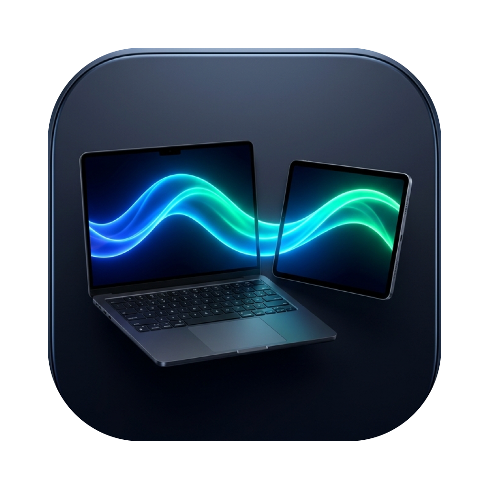

<a id="readme-top"></a>

<div align="center">



<h1>SideKick</h1>

<p><em>Turn your Android tablet into a second display for multiple MacBooks — USB-C or wireless over WiFi with instant Multi-Mac Takeover</em></p>

<p>
  <a href="https://github.com/kleinski/SideKick/blob/main/LICENSE">
    
  </a>
</p>


</div>

---

## SideKick – Eigenständiger Fork von SideScreen

**SideKick** (`https://github.com/kleinski/SideKick`) ist ein eigenständiger Fork von [tranvuongquocdat/SideScreen](https://github.com/tranvuongquocdat/SideScreen), erweitert für den nahtlosen Betrieb eines Android-Tablets mit **mehreren MacBooks**:

- **Multi-Mac Wireless Pairing & Bonjour Discovery (`_sidescreen._tcp`):** Einmal pro MacBook koppeln – das Tablet speichert beliebig viele Macs dauerhaft, aktualisiert deren IP-Adressen automatisch per mDNS und verbindet sich beim Start automatisch, wenn genau ein gekoppeltes MacBook online ist (oder zeigt eine Vorauswahl an, wenn mehrere gleichzeitig online sind).
- **Zwei-Wege-Takeover (`⌘⇧T`):** Das Tablet kann jederzeit während eines laufenden Streams per 1-Tap vom Mac (Menüleiste, Settings-Footer, Shortcut `⌘⇧T`, URL-Schema) oder direkt auf dem Tablet (In-Stream-Einstellungen) auf ein anderes MacBook umgeschaltet werden (signiertes UDP-Handover auf Port `54322`).
- **On-Demand Virtual Display & Disconnect Tablet (`⌘⇧D`):** Das virtuelle macOS-Display wird erst erzeugt, wenn sich ein Tablet tatsächlich verbindet, und beim Trennen sofort wieder zerstört – es verschwinden nie wieder Fenster auf einem unsichtbaren Zweitbildschirm. Mit **Disconnect Tablet** (`⌘⇧D`) lässt sich das Tablet trennen, während der Streaming-Server im Standby weiterlauscht.
- **Live-Auflösungs-, HiDPI- & Refresh-Rate-Wechsel:** Änderungen an Auflösung, Retina/HiDPI oder Bildwiederholrate bauen das virtuelle Display im laufenden Betrieb neu auf, ohne die Tablet-Verbindung zu verlieren.
- **4-Tab Settings UI & Hintergrundbetrieb:** Übersichtliche Aufteilung in *Connection*, *Display & Touch*, *Stream & Quality* und *System & Status*. Beim Schließen des Einstellungsfensters (`×` / `⌘W`) läuft SideKick ruhig in der Menüleiste weiter.
- **Persistentes Code-Signing & Automatischer TCC-Reset:** Unterstützt ein lokales Code-Signing-Zertifikat (`./scripts/setup_signing_cert.sh` -> `"SideKick Local Signing"`) sowie automatisches `tccutil reset` bei Binär-Updates, damit macOS-Berechtigungen (*Screen Recording* & *Accessibility*) bei Updates nicht manuell gelöscht werden müssen.
- **URL-Schema, CLI & Vorssaint-Integration:**
  - **URL-Schema:** `sidekick://takeover`, `sidekick://disconnect`, `sidekick://toggle`, `sidekick://start`, `sidekick://stop`, `sidekick://settings`
  - **CLI-Flags:** `/Applications/SideKick.app/Contents/MacOS/SideScreen --takeover` (oder `--disconnect`, `--toggle`, `--start`, `--stop`, `--settings`)
  - **Vorssaint Command Bar:** Automatische Registrierung beim ersten Start (sowie manuell unter *Settings → System & Status → Maintenance & Integrations*).
- **Eigenständige App-Identität:** Durchgehend `SideKick.app` (`com.sidekick.app` auf macOS & Android) mit deaktivierten Upstream-Auto-Updatern (Sparkle / Google Play).

---

<div align="center">
  
</div>

---

## About

Side Screen brings true second-display functionality to your Android tablet — over USB-C cable for the lowest latency, or wirelessly over WiFi after a one-time QR pair. Something macOS doesn't natively support either way.

While Apple's Sidecar only works with iPads, millions of Android tablets sit unused as potential workstations. Side Screen bridges that gap with hardware-accelerated H.265 streaming, sub-16ms pipeline latency on USB, and full touch input — making your tablet feel like a real monitor, not a laggy mirror.

Built entirely open-source, Side Screen is designed to be fast, lightweight, and seamlessly integrated.

For full details, features, and documentation, please visit **[sidescreen.dev](https://sidescreen.dev)**

<p align="right"><a href="#readme-top">↑ Back to top</a></p>

---

## Features

### USB-C or Wireless

Two ways to connect, same picture quality. **USB-C** plugs in the cable for the lowest possible latency — adb-reverse port forwarding is set up automatically. **Wireless** lets you scan a QR code from the Mac once and the tablet auto-reconnects on every future launch over WiFi (5 GHz strongly recommended). The auth token is generated locally and stays on your Mac; reset it any time to revoke access.

### Virtual Display

Create a true virtual display on your Mac. Drag windows to your tablet like a real monitor — not mirroring, but extending.

<div align="center">
  
</div>

### Ultra-Low Latency

Hardware-accelerated H.265 encoding on Mac and decoding on Android. Async pipeline architecture delivers frames in under 30ms.

<div align="center">
  
</div>

### Touch Support

Use your tablet's touchscreen to interact with macOS. Touch prediction compensates for network latency, making taps and drags feel natural.

### HiDPI (Retina) Support

Enable HiDPI mode to render at 2× resolution internally — text and icons are sharp at any logical resolution, just like a MacBook Retina display. Perfect for users with 2K/4K tablets who want a readable workspace without sacrificing sharpness.

### Gaming Mode

Enable Gaming Boost for optimized settings: 1 Gbps bitrate, ultra-low latency encoding, 120 FPS.

### Customizable

Configure resolution (up to 4K/8K), frame rate (30–120 FPS), bitrate (20–5000 Mbps), and quality presets from the Mac app.

<div align="center">
  
  &nbsp;&nbsp;
  
  &nbsp;&nbsp;
  
</div>

### Headless / portable Mac (new in 0.11.0)

Run a Mac with no display of its own — a Mac Studio or Mini on the go, or a laptop in clamshell — using the tablet as its only screen. Enable Launch at Login and Auto-start streaming, and the Mac boots straight into serving the tablet, with nothing to press on the Mac.

<p align="right"><a href="#readme-top">↑ Back to top</a></p>

---

## Requirements

| | macOS Host | Android Client |
|---|---|---|
| **OS** | macOS 13 (Ventura)+ | Android 8.0 (API 26)+ |
| **Hardware** | Apple Silicon or Intel | H.265 hardware decoder |
| **USB mode** | USB-C port + `adb` (`brew install android-platform-tools`) | USB-C cable + USB Debugging enabled |
| **Wireless mode** | Same WiFi network as the tablet (5 GHz recommended) | Camera (for QR scan) + Google Play Services (for ML Kit barcode) |

---

## Installation

- **Android**: [Get it on Google Play](https://play.google.com/store/apps/details?id=com.sidescreen.app) — updates install automatically.
- **macOS**: Download the `.dmg` from [**GitHub Releases**](https://github.com/tranvuongquocdat/SideScreen/releases), open it, drag Side Screen to Applications. The app is signed and notarized by Apple, and checks for updates on its own. Port forwarding over USB is handled automatically by the Mac app.

> **⚠️ ADB Required**
> The Mac app needs `adb` to communicate with your Android device. If the app doesn't show "Running" after launch, you likely need to install ADB:
>
> 1. Install Homebrew (if you don't have it):
>    ```bash
>    /bin/bash -c "$(curl -fsSL https://raw.githubusercontent.com/Homebrew/install/HEAD/install.sh)"
>    ```
> 2. Install ADB:
>    ```bash
>    brew install --cask android-platform-tools
>    ```

<details>
<summary><strong>Build from source (for developers)</strong></summary>

```bash
git clone https://github.com/tranvuongquocdat/SideScreen.git
cd SideScreen

# macOS
cd MacHost && swift build -c release

# Android
cd AndroidClient && ./gradlew assembleDebug
```
</details>

---

## Usage

### USB mode (default — lowest latency)

1. Connect tablet to Mac via **USB-C**
2. Launch **Side Screen** on Mac (runs in menu bar — port forwarding is set up automatically)
3. Open **Side Screen** on tablet → keep on the **USB** tab → tap **Connect**
4. Done — drag windows to your new display

### Wireless mode (new in 0.8.0 — no cable)

1. Launch **Side Screen** on Mac → toggle to the **Wireless** tab → a QR code appears
2. Open **Side Screen** on tablet → switch to the **Wireless** tab → tap **Scan QR Code** → grant camera permission → aim at the QR on the Mac
3. The tablet remembers the Mac. Subsequent launches auto-reconnect — no rescan.

Wireless mode requires both devices to be on the same WiFi network. **5 GHz is strongly recommended** — 2.4 GHz can introduce noticeable jitter on dynamic content. If you need to revoke access, click **Reset Token (forget all)** on the Mac and re-pair each tablet.

USB mode remains the lowest-latency option for drawing or fast-paced gaming. Wireless adds 10–50 ms depending on WiFi quality.

### Headless mode (new in 0.11.0 — no Mac interaction)

In Settings → Startup, turn on **Launch at Login** and **Auto-start streaming on launch**, then pick the **Startup mode** (USB or Wireless). On your next login the server starts automatically — just open Side Screen on the tablet and tap Connect (USB) or Reconnect (Wireless).

First-time setup still needs a screen once to grant Screen Recording permission; after that the Mac runs fully headless. For wireless headless use, give the Mac a static IP or DHCP reservation, and consider enabling macOS Screen Sharing as a fallback way in.

---

## Configuration

| Setting | Options | Default |
|---------|---------|---------|
| Resolution | 720p to 8K, 30+ presets + custom | 1920x1200 |
| Frame Rate | 30, 60, 90, 120 FPS | 120 |
| Bitrate | 20–5000 Mbps | 1000 Mbps |
| Quality | Ultra Low, Low, Medium, High | Ultra Low |
| HiDPI (Retina) | On/Off | Off |
| Gaming Boost | On/Off (1 Gbps, 120 Hz) | Off |
| Touch Input | On/Off | On |

---

## Troubleshooting

<details>
<summary><strong>"SideScreen is damaged" on macOS</strong></summary>

Versions before 1.1.0 were not notarized. Update to the latest release from [GitHub Releases](https://github.com/tranvuongquocdat/SideScreen/releases), which opens without any workaround. If you must keep an old version, run `sudo xattr -cr /Applications/SideScreen.app` once.
</details>

<details>
<summary><strong>"Connection refused" on Android</strong></summary>

The Mac app sets up `adb reverse` automatically when streaming starts. If it still fails, make sure `adb` is installed (via Android SDK or Homebrew: `brew install android-platform-tools`) and your device has USB debugging enabled.
</details>

<details>
<summary><strong>High latency or stuttering</strong></summary>

- Lower resolution or frame rate
- Ensure H.265 hardware codec support on your device
- For USB mode, use a high-quality USB-C cable (not charge-only)
- For wireless mode, ensure both devices are on **5 GHz WiFi**, not 2.4 GHz; reduce refresh rate to 60 Hz if jitter persists
</details>

<details>
<summary><strong>Wireless: "Couldn't reach Mac" / connection times out</strong></summary>

- Both devices must be on the same WiFi network (and same subnet — some mesh routers isolate "guest" devices)
- Click **Start** on the Mac before scanning the QR — the listener only binds when the server is running
- If the Mac changes WiFi or its LAN IP, scan a fresh QR (the cached one points to the old address)
- macOS may prompt for **Local Network** permission on first wireless toggle — grant it; without it, LAN inbound is silently dropped
</details>

<details>
<summary><strong>Wireless: "Re-pair required" after restart / reinstall</strong></summary>

The Mac's auth token resets when you click **Reset Token (forget all)** or reinstall the app. Tap **Scan QR Code** on the Android client and scan the new QR shown on the Mac.
</details>

<details>
<summary><strong>Tablet goes black whenever an app is fullscreen on the Mac</strong></summary>

This is macOS, not the stream: with **"Displays have separate Spaces"** turned off, macOS blanks every other display — including the virtual one the tablet shows — as soon as any app enters fullscreen. Turn it on in **System Settings → Desktop & Dock → Mission Control → Displays have separate Spaces**, then log out and back in. The Mac app shows a warning in its Status panel when this setting is off.
</details>

<details>
<summary><strong>Virtual display not appearing</strong></summary>

Grant Screen Recording permission: **System Preferences → Privacy & Security → Screen Recording → Enable Side Screen**
</details>

---

## Contributing

Contributions are welcome!

- ⭐ **Star** this repo to help others discover it
- 🐛 **Report bugs** via [Issues](https://github.com/tranvuongquocdat/SideScreen/issues)
- 💡 **Suggest features** via [Issues](https://github.com/tranvuongquocdat/SideScreen/issues)
- 🔧 **Submit PRs** — see [CONTRIBUTING.md](CONTRIBUTING.md)

---

## Support

If Side Screen is useful to you, consider supporting development:

<div align="center">

[](https://buymeacoffee.com/tranvuongqk)
[](https://github.com/sponsors/tranvuongquocdat)
[](https://sidescreen.dev/donate.html)

</div>

🇻🇳 Vietnamese users — scan VietQR for a local bank transfer (no international fees) at [sidescreen.dev/donate](https://sidescreen.dev/donate.html).

---

## License

[MIT License](LICENSE) — free for personal and commercial use.

---

<div align="center">

Made with ❤️ by **Tran Vuong Quoc Dat**

[Report Bug](https://github.com/tranvuongquocdat/SideScreen/issues) · [Request Feature](https://github.com/tranvuongquocdat/SideScreen/issues) · [Discussions](https://github.com/tranvuongquocdat/SideScreen/discussions)

</div>
